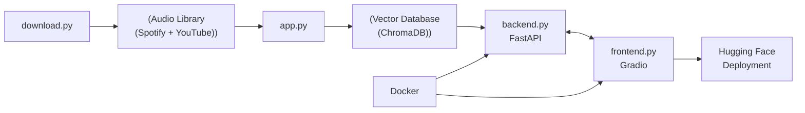

<div align="center">

# 🎵 Music Recommendation System

**Discover music you'll love - powered by deep audio embeddings and semantic vector search**


[Overview](#-project-overview) · [How It Works](#-how-it-works) · [Features](#-key-features) · [Structure](#-project-structure) · [Use Cases](#-use-cases)

</div>

---

## 📖 Overview

The **Music Recommendation System** ingests raw audio files, converts them into high-dimensional **semantic embeddings** using a state-of-the-art music foundation model, stores them in a persistent **vector database**, and surfaces the most acoustically similar tracks - all through a clean browser UI.

Unlike metadata-based recommenders that rely on genre tags or play-count statistics, this system works at the signal level: it encodes the actual audio waveform into a 1024-dimensional representation that captures timbre, rhythm, and harmonic structure. Similarity is then measured by **cosine similarity** in embedding space, with no manual feature engineering required.

> 💡 **Tip:** The more songs are indexed, the better the recommendations.
---

## 🧠 How It Works

### System Architecture



### Step-by-step pipeline

**1. Audio ingestion**
Songs are read from the `songs/` folder (MP3, M4A, WAV, FLAC, OGG). `download.py` can populate that folder directly from a Spotify playlist URL (via `spotdl`) or a YouTube playlist URL (via `yt-dlp`), with parallel workers and automatic deduplication by title.

**2. Audio preprocessing**
Each file is resampled to **24 kHz mono** using `librosa`. Three non-overlapping 15-second clips are extracted — from the start, middle, and end of the track — giving the model a balanced view of the full song. Files shorter than 45 seconds are zero-padded.

**3. Audio feature extraction with MERT**
Each clip is passed through **MERT-v1-330M** (`m-a-p/MERT-v1-330M`), a 330-million-parameter music encoder pre-trained with **masked acoustic modelling**. The model is a stack of Transformer layers that perform **representation learning** directly on the raw waveform, with no hand-crafted spectral features needed.

**4. Embedding aggregation**
Hidden states from layers **12, 16, and 18** are averaged across time and then averaged together, yielding a single **1024-dimensional semantic embedding** per song. Using multiple mid-to-late layers balances local acoustic detail with high-level musical structure.

**5. Vector database upsert**
Embeddings are written to a **ChromaDB** `PersistentClient` collection (`"songs"`, cosine space) in chunks of 16, with an overlap-safe upsert strategy that acts as a resumable checkpoint. A `ThreadPoolExecutor` with 4 workers decodes the next chunk on CPU while the GPU embeds the current one, keeping both resources busy. Songs removed from `songs/` are automatically deleted from the collection.

**6. Playlist-aware classification (optional)**
When songs are organised into per-playlist sub-folders, a **`PlaylistCNN`** trains on the stored embeddings. The architecture:

| Layer | Config |
|---|---|
| `Conv1d` (1→32) | kernel 9, stride 4 |
| `Conv1d` (32→64) | kernel 9, stride 4 |
| `Conv1d` (64→128) | kernel 9, stride 4 |
| `AdaptiveAvgPool1d(1)` | global average |
| `Dropout(0.3)` + `Linear(128, C)` | output classes |

Training uses **AdamW** (lr 1e-3), **CrossEntropyLoss**, batch size 16, up to 40 epochs, with **early stopping** (patience 5) on validation loss and an 80/20 stratified split. The best checkpoint is saved to `data/model.pt`. If all songs share the same flat `songs/` folder (one label), CNN training is skipped automatically.

> ⚠️ **Note:** Recommendations are always served by ChromaDB cosine search — the CNN is a playlist classifier, not the retrieval engine.

**7. REST API + interactive UI**
A **FastAPI** backend exposes the full **inference pipeline** over HTTP. A **Gradio** frontend renders a searchable dropdown, a recommendation slider, a results table with similarity scores, and an in-browser audio preview - no separate media player required.

---

## ✨ Key Features

| Feature | Detail |
|---|---|
| 🎙️ **Deep audio embeddings** | MERT-v1-330M; 1024-dim vectors from raw waveforms |
| 🗄️ **Persistent vector database** | ChromaDB with cosine HNSW index; survives restarts |
| ⚡ **Incremental indexing** | Chunk-level upsert; resumes after interruption |
| 🔀 **Parallel ingestion** | ThreadPoolExecutor: decode next / embed current |
| 🎛️ **1D CNN classifier** | Playlist-label training with early stopping; auto-skipped when flat |
| 🌐 **REST API** | FastAPI with asynchronous background workers for index + download jobs |
| 🖥️ **Browser UI** | Gradio; live search, ✕ clear, ▶ audio preview, status polling |
| 📥 **Playlist ingestion** | Spotify via `spotdl`; YouTube via `yt-dlp`; title-based dedup |
| 🐳 **Containerised** | Single Docker image; MERT weights baked in; CPU-only PyTorch |
| ☁️ **Cloud-ready** | Hugging Face Docker Space deployment with pre-built `data/chroma` |

---

## 🗂️ Project Structure

```
Music-Recommendation-System/
│
├── songs/                  # Audio library (MP3, M4A, WAV, FLAC, OGG)
│   └── PlaylistA/          # Optional: per-playlist sub-folders for CNN training
│       └── track.mp3
│
├── data/                   # Generated at runtime
│   ├── chroma/             # ChromaDB persistent store (vector embeddings)
│   └── model.pt            # Best PlaylistCNN checkpoint (when trained)
│
├── app.py                  # Core pipeline: embedding, indexing, ChromaDB, CNN, recommendations
├── backend.py              # FastAPI server - REST endpoints, background job queue
├── frontend.py             # Gradio UI - search, recommend, download, audio preview
├── download.py             # Playlist ingestion - Spotify (spotdl) + YouTube (yt-dlp)
├── predict.py              # CLI - keyword search → pick a song → top-5 results
│
├── requirements.txt        # Pinned dependencies
├── Dockerfile              # python:3.12-slim; MERT baked in; CPU torch
├── .dockerignore           # Excludes songs/, *.mp3, data/*.npz, .venv/
└── docker-compose.yml      # Volume mounts for songs/ and data/; port 7860
```

| File | Responsibility |
|---|---|
| `app.py` | Audio loading, MERT inference, ChromaDB upsert/query, CNN training, `recommend()` |
| `backend.py` | HTTP layer; `/recommend`, `/index`, `/download`, `/audio`, `/songs` endpoints; job status |
| `frontend.py` | Gradio tabs; real-time dropdown search; results table; ▶ play; status polling every 3 s |
| `download.py` | `spotdl save` + chunked download; `yt-dlp` flat playlist extract; parallel workers; dedup |
| `predict.py` | Interactive CLI; calls `recommend()` directly; no server required |

---

## 🔭 Use Cases

- **Personal music discovery** - index your entire local library and explore it by acoustic similarity rather than genre tags.
- **Playlist curation** - seed a recommendation with one track and build a cohesive set for DJ sets or workout playlists.
- **Audio dataset exploration** - use the vector database as a semantic index to audit large collections for near-duplicates or outliers.
- **Retrieval-augmented pipelines** - expose the `/recommend` endpoint to downstream services that need audio-conditioned retrieval (e.g., video background music matching).
- **Transfer learning research** - swap the MERT backbone for any Hugging Face audio encoder and benchmark representation learning quality via retrieval metrics.
- **Containerisation & reproducibility** - the Docker image ships with model weights baked in and a `--no-install-recommends` base, making it easy to reproduce the full inference pipeline on any machine.

---

## 📄 License

Distributed under the [MIT License](LICENSE).

**Built with** · [MERT](https://huggingface.co/m-a-p/MERT-v1-330M) · [ChromaDB](https://www.trychroma.com) · [FastAPI](https://fastapi.tiangolo.com) · [Gradio](https://www.gradio.app) · [spotdl](https://spotdl.readthedocs.io) · [yt-dlp](https://github.com/yt-dlp/yt-dlp) · [Docker](https://www.docker.com)

</div>
