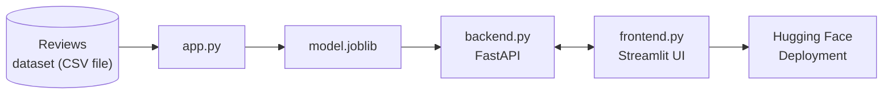

<div align="center">

# 🍽️ Restaurant Review Sentiment Analysis

### Classify any restaurant review as Positive or Negative - from raw text to a production inference API


[Overview](#-overview) · [How It Works](#-how-it-works) · [Features](#-key-features) · [Structure](#-project-structure) · [Use Cases](#-use-cases--future-extensions)

</div>

---

## 📖 Overview

Online restaurant reviews are short, opinionated, and full of negations and slang - making them harder to classify reliably than longer product reviews. Manual triage is impractical at scale, yet a simple keyword search misses phrases like "not good at all" or "won't come back."

**Restaurant Review Sentiment Analysis** solves this by combining a carefully tuned NLP preprocessing pipeline with a Multinomial Naïve Bayes classifier, delivered through a FastAPI backend and a Streamlit web app. It classifies any English restaurant review - typed individually or submitted in bulk - as **Positive** or **Negative**, and returns a calibrated confidence score alongside the words that drove the decision.

The dataset comprises **1,000 balanced reviews** (500 positive, 500 negative) averaging 10 words per review. The final model achieves **83% test accuracy** with balanced precision and recall across both classes.

---

## 🧠 How It Works

### System Architecture



| Layer | Implementation |
|---|---|
| **Training & EDA** | `app.py` - data wrangling, text preprocessing, TF-IDF vectorization, 10-fold GridSearchCV, evaluation, and artifact export |
| **Model artifact** | `model.joblib` - a scikit-learn Pipeline containing a fitted TF-IDF vectorizer and a tuned Multinomial Naïve Bayes classifier |
| **Inference API** | `backend.py` - FastAPI service: validates input, cleans text, scores the review, and returns label, confidence, and top influential words |
| **Interactive UI** | `frontend.py` - Streamlit app: single-review tab with example buttons, batch tab with paste or CSV/TXT upload, summary metrics, bar chart, and downloadable results table |
| **Deployment** | Hugging Face Space - Streamlit frontend connects directly to the FastAPI backend |

---

### Step-by-Step Pipeline

**Step 1 · Data Loading & Exploratory Analysis**

`Restaurant_Review.csv` is loaded with Pandas into a 1,000 × 2 DataFrame (`review`, `liked`). The class distribution is perfectly balanced at 500 positive and 500 negative reviews. EDA covers character and word counts per class, a class-balance bar chart, and a word-count histogram to surface any length bias before modeling.

**Step 2 · Text Preprocessing**

A `clean_text()` function applies these transformations in order, designed to preserve sentiment-bearing negation words:

| Step | What it does | Key choice |
|---|---|---|
| Lowercase | Normalizes case | Standard |
| HTML & URL stripping | Removes noise | `re.sub` |
| Contraction expansion | `won't → will not`, `n't → not` | Preserves negation |
| Punctuation removal | Strips non-alpha characters | `re.sub` |
| Tokenization | Splits into word tokens | NLTK `word_tokenize` |
| Stopword removal | Drops common words | Keeps `no`, `not`, `nor`, `very`, `too`, `more`, `most`, `only` |
| Lemmatization | Reduces inflection | NLTK `WordNetLemmatizer` - verb then noun pass |

> 💡 **Kept negation words** Standard stopword lists drop `not`, turning "not good" into "good" and flipping the sentiment signal. Retaining them is the single most impactful preprocessing decision on this dataset.

**Step 3 · Feature Engineering & Text Representation**

Reviews are converted to numeric vectors using **TF-IDF** (Term Frequency–Inverse Document Frequency) with **sublinear TF scaling** to dampen the effect of frequently repeated words. Unigrams and bigrams (`ngram_range=(1, 2)`) are included, so phrases like "not good" and "never again" are captured as single features alongside individual words. The vocabulary after fitting on the training set covers **4,874 unique terms**.

**Step 4 · Model Training & Hyperparameter Tuning**

Training and evaluation follow a strict 80/20 stratified split. A scikit-learn `Pipeline` wrapping `TfidfVectorizer → MultinomialNB` is tuned with **10-fold stratified GridSearchCV**, exploring:

| Hyperparameter | Search space |
|---|---|
| `ngram_range` | `(1, 1)`, `(1, 2)` |
| `min_df` | `1`, `2` |
| `nb__alpha` | `0.05`, `0.1`, `0.3`, **`0.5`**, `1.0` |

The best configuration — `ngram_range=(1, 2)`, `min_df=1`, `alpha=0.5` - was selected by cross-validation accuracy and re-fit on the full training set before evaluation on the held-out test set.

> 💡 **Why Multinomial Naïve Bayes?** With ~1000 short training reviews, Naïve Bayes is ideal: it has very few parameters, trains in milliseconds on sparse TF-IDF matrices, and is well-calibrated for text classification at this scale. A Neural Network on the same data would have orders of magnitude more parameters to fit from less than a thousand examples.

**Step 5 · Model Evaluation**

Evaluated on the 200-review held-out test set:

| Metric | Negative | Positive | Overall |
|---|---|---|---|
| Precision | 0.84 | 0.82 | 0.83 |
| Recall | 0.82 | 0.84 | 0.83 |
| F1-score | 0.83 | 0.83 | 0.83 |
| **Accuracy** | - | - | **83%** |

The confusion matrix shows 82 true negatives, 84 true positives, 18 false positives, and 16 false negatives - with no meaningful class bias in either direction.

**Step 6 · Inference Pipeline**

At inference time, `backend.py` loads `model.joblib` once at startup and applies the same `clean_text()` function used during training before passing the cleaned text to the pipeline's `transform → predict_proba` chain. Per-word log-odds weights (`feature_log_prob_[1] - feature_log_prob_[0]`) are computed at startup to identify the top 5 words that pushed each prediction toward Positive or Negative. Reviews that contain no vocabulary known to the model - after cleaning - are flagged as **Unknown** rather than returned with a misleading 50/50 guess.

---

## ⚡ Key Features

| | Feature | Detail |
|---|---|---|
| 🎯 | **Single review prediction** | Type or paste any review; get Positive/Negative with emoji, confidence %, and positive-probability bar |
| 📂 | **Batch analysis** | Paste reviews (one per line) or upload a CSV (with a `review` column) or TXT file; cap of 500 reviews per batch |
| 📊 | **Summary metrics** | Total, Positive, Negative, and Unrecognised counts with a bar chart after batch analysis |
| 📋 | **Centered results table** | Sr. No. (from 1), Review, Label, Confidence (to 2 decimal %) - rendered as HTML for consistent alignment |
| ⬇️ | **CSV export** | Download batch results with one click |
| 🔌 | **REST API** | `GET /`, `GET /health`, `POST /predict`, `POST /predict-batch` - with Pydantic validation and auto-generated Swagger docs at `/docs` |
| 🛡️ | **Input guardrails** | Blank reviews rejected (422); reviews capped at 2,000 characters; batches capped at 500; Unknown returned for no-vocabulary input |
| 🔍 | **Word-level explainability** | Top 5 log-odds-weighted terms returned per prediction, showing which words drove the result |
| ❤️ | **Backend health check** | Sidebar shows live green/red connection status; `GET /health` endpoint reports model type |
| 📌 | **Example buttons** | Pre-loaded positive and negative examples in the Review tab for one-click demos |

---

## 📁 Project Structure

```text
Restaurant Review Sentiment Analysis/
├── Restaurant_Review.csv    # Source dataset
├── app.py                   # EDA + training pipeline
├── backend.py               # FastAPI inference service
├── frontend.py              # Streamlit web app
├── model.joblib             # Trained pipeline artifact
└── requirements.txt         # Pinned Python dependencies
```

| File | Role |
|---|---|
| `Restaurant_Review.csv` | Source dataset - 1,000 English restaurant reviews, balanced 500 positive / 500 negative, two columns: `review` (text) and `liked` (0 / 1) |
| `app.py` | End-to-end training workflow organized as `# %%` cells: data loading, EDA (class balance, word-count distributions), text preprocessing, TF-IDF feature extraction, 10-fold GridSearchCV, test-set evaluation, confusion matrix, and `model.joblib` export |
| `backend.py` | **FastAPI** inference service - loads `model.joblib` at startup, exposes `GET /`, `GET /health`, `POST /predict`, `POST /predict-batch`; performs `clean_text()` → TF-IDF transform → Naïve Bayes scoring → log-odds word-impact extraction on every request |
| `frontend.py` | **Streamlit** web app - two tabs: **Review** (single prediction with example buttons) and **Upload** (batch paste or file upload, summary metrics, bar chart, center-aligned HTML results table, CSV download) |
| `model.joblib` | Serialized scikit-learn Pipeline: `TfidfVectorizer(ngram_range=(1,2), sublinear_tf=True)` + `MultinomialNB(alpha=0.5)` - 4,874-term vocabulary, trained on 800 reviews |
| `requirements.txt` | Pinned dependencies for a reproducible environment - 11 packages across data, NLP, ML, API, and UI layers |

---

## 💡 Use Cases & Future Extensions

### Applications

| Audience | How this system helps |
|---|---|
| 🍴 **Restaurant operators** | Upload a week's worth of review-platform exports and instantly see the positive/negative split and which reviews need a response |
| 📣 **Marketing & reputation teams** | Monitor brand sentiment trends across batches of collected reviews without manual reading |
| 🏫 **NLP learners** | A clean, fully annotated end-to-end pipeline - from raw text through preprocessing, TF-IDF, Naïve Bayes, and a deployed REST API - that fits in five files |
| 🔬 **Data science researchers** | A reproducible baseline for benchmarking more complex models (LSTM, transformer fine-tuning) on the same dataset and train/test split |

### Natural Next Steps

- **Confidence threshold tuning:** expose the 0.60 "uncertain" threshold as a configurable parameter so operators can tune precision vs. recall for their use case.
- **Aspect-level sentiment:** break predictions down by food, service, ambience, and price using a multi-label extension or a secondary classifier.
- **A three-class model (Neutral):** collect mixed-sentiment reviews and train a Positive / Neutral / Negative classifier to handle the "it was okay" edge case more precisely.
- **Retraining pipeline:** add a feedback button that logs mis-classifications, accumulates them, and triggers a retraining run once a threshold is met.
- **Multilingual support:** swap NLTK lemmatization for a language-agnostic preprocessor and extend the dataset to cover non-English reviews.

---

## 📜 License & Acknowledgements

Released under the **MIT License**.

**Dataset**
Restaurant reviews compiled from public sources for binary sentiment classification (500 positive, 500 negative).

**Built with**

[scikit-learn](https://scikit-learn.org/) · [NLTK](https://www.nltk.org/) · [Pandas](https://pandas.pydata.org/) · [NumPy](https://numpy.org/) · [Matplotlib](https://matplotlib.org/) · [Seaborn](https://seaborn.pydata.org/) · [FastAPI](https://fastapi.tiangolo.com/) · [Streamlit](https://streamlit.io/) · [Hugging Face Spaces](https://huggingface.co/spaces)
