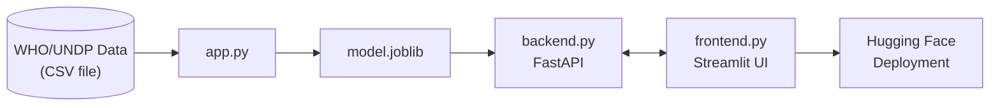

# 🩺 Maternal Mortality Ratio Predictor

End-to-end public health ML pipeline - from longitudinal WHO/UNDP data to a risk-assessment API


[Overview](#overview) [How It Works](#how-it-works) [Key Features](#key-features) [Project Structure](#project-structure) [Use Cases](#use-cases)

## 📖 Overview

Maternal mortality remains one of the most preventable public health crises of our time, yet the data that could drive targeted policy interventions - spanning 195 countries from 1990 to 2021 - is rarely distilled into actionable risk signals. Identifying which regions are at highest risk, and how that risk evolves with demographic and development trajectories, requires a pipeline that moves beyond summary statistics to **predictive, longitudinal modeling**.

This project builds a **complete end-to-end machine learning system** trained on WHO and UNDP data. It goes from raw wide-format country-year records through imputation, feature engineering, gradient-boosted regression with cross-validated hyperparameter tuning, and a production-grade **REST API** and **Streamlit dashboard** - all packaged for deployable on **Hugging Face Spaces**.

## 🧠 How It Works

### System Architecture



| Layer | Implementation |
| --- | --- |
| **Training & EDA** | `app.py` - data loading, wide→long reshape, missing-value imputation, feature engineering, log₁₀ target transformation, LightGBM training, RandomizedSearchCV hyperparameter tuning, and `model.joblib` export |
| **Inference artifact** | `model.joblib` - fitted LightGBM model, feature column list, label encoders, interaction encoder, scaler, best hyperparameters, and test-set metrics |
| **Inference pipeline** | `backend.py` - FastAPI service: Pydantic-validated single and batch prediction endpoints, feature construction, back-transformation from log₁₀ scale, and risk label assignment |
| **Interactive UI** | `frontend.py` - Streamlit app: single prediction with Plotly gauge, year-sweep trend chart, and batch CSV upload with animated choropleth |
| **Packaging & Deployment** | Compose-orchestrated with health checks; deployable to **Hugging Face Spaces** |

### Step 1 · Data Pipeline & Imputation

The raw dataset (`Maternal_Mortality.csv`) covers **195 countries** with MMR values for each year from 1990 to 2021, alongside static metadata: continent, hemisphere, Human Development Group (HDG), UNDP Developing Region, and HDI Rank (2021). It arrives in wide format and is reshaped to long form before cleaning.

- **MMR**: imputed with the continent-year median to preserve regional temporal trends.
- **UNDP Region**: imputed with the group mode (by continent × HDG) to respect categorical structure.
- **HDI Rank**: imputed with the group mean (by continent × HDG) using a continuous approximation.

### Step 2 · Feature Engineering

Four categorical columns are **label-encoded** before model training (continent, hemisphere, human development group, UNDP region). Four derived numeric features are then constructed to give the model richer temporal and distributional signal:

| Feature | Formula / Source | Purpose |
| --- | --- | --- |
| `decade` | `year // 10 * 10` | Captures decade-level policy and infrastructure shifts |
| `years_elapsed` | `year − 1990` | Encodes time since the start of the observation window |
| `hdi_quintile` | `pd.qcut(HDI Rank, 5)` | Bins countries into development tiers for nonlinear HDI effects |
| `continent_hdg_enc` | LabelEncoder on `continent + "_" + HDG` | Captures interaction effects between geography and development group |

### Step 3 · Log₁₀ Target Transformation

MMR values are right-skewed across four orders of magnitude - from under 2 to over 2,000 maternal deaths per 100,000 live births. The model trains on **`log₁₀(MMR)`** and predictions are back-transformed with `10^ŷ` before being returned to callers. This normalization materially improves gradient boosting performance on this distribution without requiring outlier removal.

### Step 4 · Model Training & Hyperparameter Tuning

A **LightGBM** regressor is selected for its strong performance on tabular data with mixed categorical and numeric features, its native handling of missing values, and its training speed at this dataset scale.

| Setting | Value |
| --- | --- |
| Algorithm | LightGBM Gradient Boosted Regression Trees |
| Target | `log₁₀(MMR)` (back-transformed at inference) |
| Cross-validation | 10-fold KFold, `random_state=42` |
| Search strategy | RandomizedSearchCV, 30 iterations |
| Scoring | Negative Root Mean Squared Error |
| Hyperparameter grid | `n_estimators`, `learning_rate`, `max_depth`, `num_leaves`, `min_child_samples`, `subsample`, `colsample_bytree` |
| Feature columns (10) | Encoded categoricals + Year + HDI Rank + decade + years_elapsed + hdi_quintile + continent_hdg_enc |

### Step 5 · Model Evaluation

<table>
  <tr>
    <td align="center" width="25%" style="background-color:#0e151d; border:1px solid #1f2937; border-radius:10px; padding:16px 8px;">
      <div style="font-size:28px; font-weight:800; color:#539bf5; line-height:1.2;">R²</div>
      <div style="font-size:11px; font-weight:600; color:#8b949e; letter-spacing:0.6px; margin-top:8px; line-height:1.4;">COEFFICIENT OF<br/>DETERMINATION</div>
    </td>
    <td align="center" width="25%" style="background-color:#0e151d; border:1px solid #1f2937; border-radius:10px; padding:16px 8px;">
      <div style="font-size:28px; font-weight:800; color:#539bf5; line-height:1.2;">RMSE</div>
      <div style="font-size:11px; font-weight:600; color:#8b949e; letter-spacing:0.6px; margin-top:8px; line-height:1.4;">ROOT MEAN<br/>SQUARED ERROR</div>
    </td>
    <td align="center" width="25%" style="background-color:#0e151d; border:1px solid #1f2937; border-radius:10px; padding:16px 8px;">
      <div style="font-size:28px; font-weight:800; color:#539bf5; line-height:1.2;">MAE</div>
      <div style="font-size:11px; font-weight:600; color:#8b949e; letter-spacing:0.6px; margin-top:8px; line-height:1.4;">MEAN ABSOLUTE<br/>ERROR</div>
    </td>
    <td align="center" width="25%" style="background-color:#0e151d; border:1px solid #1f2937; border-radius:10px; padding:16px 8px;">
      <div style="font-size:28px; font-weight:800; color:#539bf5; line-height:1.2;">10-fold</div>
      <div style="font-size:11px; font-weight:600; color:#8b949e; letter-spacing:0.6px; margin-top:8px; line-height:1.4;">CROSS-VALIDATION</div>
    </td>
  </tr>
</table>

💡 Test metrics are stored inside `model.joblib` and exposed live through the `/model-info` endpoint, so the dashboard and API always reflect the actual trained model rather than documented estimates.

Permutation importance and MDI feature importance are both computed and plotted during training. **HDI Rank (2021)** dominates both importance measures - a country's developmental standing in 2021 is the strongest single predictor of its historical and projected MMR, even after controlling for year and regional categories.

### Step 6 · Risk Labeling

```markdown
Every prediction is assigned a human-readable risk tier based on the back-transformed MMR value:[cite: 41, 43]

| Risk Label | MMR Range (deaths per 100,000 live births) |
| :--- | :--- |
| <span style="background-color:#0f3d21; color:#4ade80; padding:4px 12px; border-radius:999px; font-weight:600; font-size:13px;">Very Low</span> | &lt; 20 |
| <span style="background-color:#0c324d; color:#38bdf8; padding:4px 12px; border-radius:999px; font-weight:600; font-size:13px;">Low</span> | 20 – 99 |
| <span style="background-color:#3b2606; color:#fbbf24; padding:4px 12px; border-radius:999px; font-weight:600; font-size:13px;">Medium</span> | 100 – 299 |
| <span style="background-color:#3d1908; color:#fb923c; padding:4px 12px; border-radius:999px; font-weight:600; font-size:13px;">High</span> | 300 – 699 |
| <span style="background-color:#3b0d11; color:#f87171; padding:4px 12px; border-radius:999px; font-weight:600; font-size:13px;">Very High</span> | ≥ 700 |
```

### Step 7 · Model Artifact Export (`model.joblib`)

All inference-time dependencies are serialized into a single self-contained bundle via `joblib.dump`:

- `model` - fitted LightGBM pipeline (best estimator from RandomizedSearchCV)
- `feature_cols` - ordered list of the 10 training features
- `label_encoders` - per-column LabelEncoders for the 4 categorical variables
- `le_interaction` - LabelEncoder for the `continent_hdg_enc` interaction string
- `scaler` - StandardScaler fitted on training features (available for scaled inference)
- `best_params` - winning hyperparameter configuration from RandomizedSearchCV
- `test_metrics` - RMSE, MAE, R² on the held-out test partition

## ⚡ Key Features

|  | Feature | Detail |
| --- | --- | --- |
| 🧠 | **LightGBM Regression Pipeline** | Gradient-boosted model trained on `log₁₀(MMR)`; predictions back-transformed at inference; handles mixed categorical and numeric features natively |
| 🔬 | **Longitudinal Feature Engineering** | Decade, years-elapsed, HDI quintile (data-driven qcut), and continent × development-group interaction term - all computed from raw inputs at both train and inference time |
| 📐 | **10-fold Cross-Validated Tuning** | RandomizedSearchCV over 30 configurations; KFold preserves temporal structure; best estimator and hyperparameters persisted in the model bundle |
| 🔌 | **Production REST API** | `POST /predict`, `POST /predict-batch`, `GET /model-info` - Pydantic-validated with Literal-typed categoricals, year range 1990–2030, and HDI rank 1–200 |
| 🖥️ | **Interactive Streamlit Dashboard** | Three tabs: single prediction with Plotly gauge, year-sweep line chart for scenario simulation, and batch CSV upload with animated choropleth and bar chart |
| 🗺️ | **Animated Choropleth** | Plotly-rendered world map of MMR by country for every year 1990–2021 - included as `10_Choropleth.html` |
| 📊 | **12 EDA Visualizations** | Global trend, continent trends, HDG and UNDP boxplots, KDE distributions, top/bottom-country rankings, correlation heatmap, feature importance, actual vs. predicted, and residuals |
| 🏷️ | **5-Tier Risk Labeling** | Every prediction returns a human-readable risk category alongside the numeric MMR estimate - suitable for direct integration into policy dashboards and triage workflows |
| ♻️ | **Reproducibility** | `random_state=42` throughout; all encoders, scaler, and best params stored in `model.joblib`; `requirements.txt` pinnable for deterministic builds |

## 📁 Project Structure

Maternal Mortality Ratio Predictor/\
├── app.py # Training pipeline: EDA → feature engineering → tuning → export\
├── backend.py # FastAPI inference service\
├── frontend.py # Streamlit dashboard (3 tabs)\
├── model.joblib # Serialized inference bundle (1.8 MB)\
├── Maternal_Mortality.csv # Source dataset - 195 countries, 1990–2021\
├── requirements.txt # Python dependencies\
├── Dockerfile # Container image definition\
├── docker-compose.yml # Backend + frontend orchestration with health check\
├── .dockerignore # Keeps training scripts and CSVs out of the image\
├── 10_Choropleth.html # Animated Plotly choropleth - MMR by country 1990–2021\
├── 11_Scatter_HDI.html # 2021 MMR vs HDI Rank scatter, colored by continent\
└── output/ # 12 static EDA and evaluation PNGs\

| File | Role |
| --- | --- |
| `app.py` | 🔬 End-to-end training: data loading, wide→long reshape, continent-median MMR imputation, group-mode UNDP imputation, group-mean HDI imputation, label encoding, interaction feature construction, log₁₀ target, RandomizedSearchCV with 10-fold KFold, model evaluation, 12 EDA plots, 2 interactive HTML exports, and `model.joblib` serialization |
| `backend.py` | 🧩 **FastAPI** inference service - loads `model.joblib` at startup; `POST /predict` for single Pydantic-validated requests; `POST /predict-batch` for lists; `GET /model-info` for feature list, test metrics, and best hyperparameters; CORS middleware enabled |
| `frontend.py` | 🖥️ **Streamlit** dashboard - Tab 1: 3-column selectboxes + HDI slider, Plotly gauge (0–2000 range) with risk label; Tab 2: year-range sweep → Plotly line chart + dataframe; Tab 3: CSV upload → batch predictions → bar chart + download button |
| `model.joblib` | 🤖 Serialized bundle: LightGBM best estimator, `feature_cols`, 4 label encoders, interaction encoder, StandardScaler, `best_params`, and `test_metrics` |
| `Maternal_Mortality.csv` | 📊 Source dataset - 195 countries; columns: ISO3, Country, Continent, Hemisphere, Human Development Groups, UNDP Developing Regions, HDI Rank (2021), MMR for each year 1990–2021 |
| `10_Choropleth.html` | 🗺️ Animated Plotly choropleth - MMR by country across all 32 years; self-contained HTML, opens in any browser (4.7 MB) |
| `11_Scatter_HDI.html` | 📈 Plotly scatter of 2021 MMR vs HDI Rank, colored by continent; interactive hover with country labels (4.6 MB) |
| `requirements.txt` | 📦 Python dependencies across data, ML, API, and UI layers |
| `Dockerfile` | 🐳 Slim Python image running both backend and frontend services |
| `docker-compose.yml` | 🧱 Runs backend on `:8000` and frontend on `:8501`; frontend waits on the backend health check |

## 🔌 API Reference

| Method | Endpoint | Description |
| --- | --- | --- |
| `GET` | `/` | Health check - confirms the API is running |
| `POST` | `/predict` | Single prediction - returns `predicted_mmr`, `risk_label`, and input echo |
| `POST` | `/predict-batch` | Batch prediction - accepts a list of request objects, returns a list of prediction dicts |
| `GET` | `/model-info` | Model metadata - feature columns, test metrics (RMSE, MAE, R²), and best hyperparameters |

#### Request Schema - `POST /predict`

```
{
  "continent":              "Africa" | "Asia" | "Europe" | "North America" | "South America",
  "hemisphere":             "Northern" | "Southern",
  "human_development_group":"Low" | "Medium" | "High" | "Very High",
  "undp_region":            "Sub-Saharan Africa" | "South Asia" | "Arab States" |
                            "Latin America and the Caribbean" | "East Asia and the Pacific" |
                            "Europe and Central Asia",
  "year":                   1990 – 2030,
  "hdi_rank":               1 – 200
}
```

💡 The `year` field accepts values up to 2030, enabling scenario simulation and forward-looking policy planning beyond the 2021 training window.

## 💡 Use Cases & Future Extensions

### Applications

| Domain | How This System Helps |
| --- | --- |
| 🏥 **Health Policy Planning** | Query any country profile across any year - including projected years - to benchmark current risk against comparable nations and model the trajectory under different development scenarios |
| 🌍 **Regional Risk Profiling** | The year-sweep tab surfaces which regions are improving fastest and which are stagnating, giving international health organizations a prioritization framework for resource deployment |
| 💰 **Resource Allocation** | The 5-tier risk label enables rules-based triage: flag Very High and High regions for intensive intervention, monitor Medium regions for regression, and track progress in Low and Very Low regions |
| 📋 **Predictive Risk Auditing** | Upload a batch CSV of country-year combinations via the dashboard to generate a full risk report - suitable for pre-meeting briefings, donor reports, and program evaluations |
| 🔬 **Epidemiological Research** | The `/model-info` endpoint exposes feature importances and test metrics for external validation; the interactive scatter plot pairs MMR directly against HDI Rank for regression and outlier analysis |

### Natural Next Steps

- **Portable model loading:** replace the hardcoded `model_path` in `backend.py` and `app.py` with an environment variable or relative path so the bundle loads correctly on any machine or in any container.
- **Scaled inference consistency:** apply the fitted `StandardScaler` to features at inference time (currently available in the bundle but not applied by `backend.py`), ensuring the inference pipeline matches the training pipeline exactly.
- **Streaming retraining:** wrap `app.py` in a CI/CD trigger that re-runs training when WHO or UNDP releases updated data, checks RMSE against the baseline in the existing bundle, and auto-promotes only on improvement.
- **Geospatial confidence intervals:** add prediction-interval estimation (quantile regression or conformal prediction) to surface not just the point estimate but the uncertainty range - critical for policy decisions in data-sparse regions.
- **Sub-national resolution:** extend the data pipeline to ingest IHME sub-national MMR estimates and add a province or state-level feature, enabling finer-grained within-country risk mapping.
- **REST API integration with DHIS2:** wire the `/predict-batch` endpoint into existing national health information systems (such as DHIS2) to surface risk labels directly in operational dashboards without requiring a standalone UI deployment.

## 📜 License & Acknowledgements

Released under the [MIT License](LICENSE).

**Data:** Maternal mortality ratio data sourced from the [World Health Organization Global Health Observatory](https://www.who.int/data/gho/data/themes/maternal-and-reproductive-health) and the [United Nations Development Programme Human Development Reports](https://hdr.undp.org/data-center/human-development-index), covering 195 countries from 1990 to 2021.

⚠️ **Policy disclaimer:** MMR predictions are model estimates derived from longitudinal demographic and development data. They are intended to support, not replace, expert public health judgment. Country-specific factors - conflict, healthcare infrastructure, data-reporting quality - may cause individual predictions to diverge from observed values. Always verify against primary data sources before making operational decisions.

Built with [LightGBM](https://lightgbm.readthedocs.io) · [scikit-learn](https://scikit-learn.org) · [Pandas](https://pandas.pydata.org) · [NumPy](https://numpy.org) · [Plotly](https://plotly.com/python/) · [FastAPI](https://fastapi.tiangolo.com) · [Streamlit](https://streamlit.io) · [Docker](https://www.docker.com) · [Hugging Face](https://huggingface.co)
