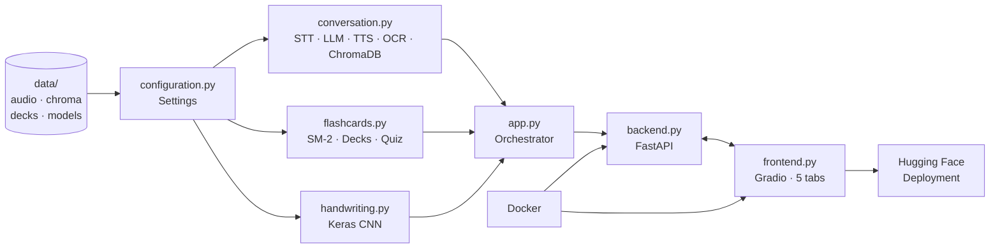

<div align="center">

# 🗣️ Multimodal Language Partner

**One app to converse, listen, read, drill, and write in seven languages - powered by local AI and spaced repetition**


[Overview](#-project-overview) · [How It Works](#-how-the-models--pipeline-work) · [Features](#-key-features) · [Structure](#-project-structure) · [Use Cases](#-use-cases--future-extensions)

</div>

---

## 📖 Overview

Language learners typically juggle five or six disconnected tools — a chatbot for conversation practice, a voice transcriber, a photo reader for menus and signs, a flashcard app, and a handwriting pad. None of them share context, adapt to the learner's CEFR level, or remember what was discussed yesterday.

**Multimodal Language Partner** collapses that stack into a single containerized application. It pairs a conversational AI partner with speech-to-text, OCR translation, SM-2 spaced-repetition flashcards and quizzes, and a CNN-powered handwriting recognition pad - all running on one port with a persistent vector-store memory that carries context across sessions.



| Layer | Responsibility |
|---|---|
| **Gradio frontend** | Five-tab browser UI on port 7860; dark CSS; consistent tab sizing |
| **FastAPI backend** | REST API, `/api/health`, request routing, Pydantic models |
| **Orchestrator** | `app.py` wires modules together; no UI or HTTP code |
| **Conversation engine** | Whisper STT, Qwen LLM, gTTS / browser-speech TTS, Tesseract OCR, ChromaDB memory |
| **Learning tools** | SM-2 flashcard scheduler, deck builder (15 cards/click), adaptive quiz |
| **Handwriting** | Pre-trained Keras CNN on MNIST & EMNIST balanced; NumPy inference in-process |
| **Configuration** | Lowercase `cfg.*` settings for data paths, model selection, device flags |
| **Data volume** | `data/audio`, `data/chroma` (ChromaDB), `data/decks`, `data/models` |

---

## 🧠 How the Models & Pipeline Work

### 1 · Conversational Generation & CEFR Adaptation

User text or transcribed speech is passed to **`Qwen/Qwen2.5-1.5B-Instruct`** (GPU) or **`Qwen/Qwen2.5-0.5B-Instruct`** (CPU), loaded via `torch` and `transformers` with a cache-first HuggingFace loader. A **prompt engineering** layer prepends the learner's target language and CEFR level, constraining generation to vocabulary and grammar appropriate for that level. A **circuit-breaker** wrapper catches model timeouts and falls back to Google Translate for the translation path.

Conversation turns are stored as **vector embeddings** in a ChromaDB `conversation_memory` collection (cosine distance, persistent on disk under `data/chroma`). **Semantic retrieval** pulls the most relevant past turns into the system prompt, giving the model a rolling long-term memory without token-window overflow.

### 2 · Speech Transcription & Text-to-Speech

Microphone audio is decoded by **`faster-whisper`** (`small` model, `int8` quantization on CPU). The pipeline accepts WAV, PyAV-decoded audio, or raw `ffmpeg` output. Transcription always targets the *spoken* language - the result is placed in the message box untranslated, so the learner edits real input before sending.

Responses are spoken back via **`gTTS`**, with a JavaScript browser-speech-synthesis fallback for environments where gTTS audio cannot be served. Audio files are cached under `data/audio` and served over the FastAPI `/audio` endpoint.

### 3 · OCR + Translation

Images submitted on the **Scan** tab are decoded by **Pillow** and passed to **`pytesseract`** with a language hint matched to the learner's target language. Seven language packs are supported: English, Spanish, German, Russian, Japanese, Chinese (Simplified), and Korean. The extracted text is then translated by the same Qwen pipeline (or Google Translate fallback), and the result is inserted into the conversation for further practice.

> ⚠️ **Note:** Tesseract accuracy on handwritten or low-contrast images is limited; for best OCR results use clear, printed text with good contrast.

### 4 · ChromaDB Memory & Spaced-Repetition Decks

Vocabulary encountered in conversation or scan sessions can be saved to named decks stored under `data/decks`. Clicking **Create Deck** generates exactly **15 cards** in one shot. Each card carries a front (target-language word), back (native-language translation), and an SM-2 scheduling state: `interval`, `ease_factor`, and `repetitions`.

The **SM-2 scheduler** adjusts `ease_factor` and `interval` after every Correct / Incorrect response - harder after a correct answer, easier after a miss - and surfaces due cards first. The **Quiz** tab samples from the same deck with adaptive difficulty: a right answer promotes the card to a harder tier, a wrong answer demotes it.

### 5 · Handwriting Segmentation & CNN Inference

The **Scribble** tab presents a large canvas with marker, eraser, thickness slider, and colour picker (black / red / green / blue). On submit, the canvas PNG is binarized, contour-segmented into individual character bounding boxes, and each character is resized to 28 × 28 pixels for **multimodal inference** through the selected CNN:

| Model | Dataset | Classes |
|---|---|---|
| `handwriting_mnist.keras` | MNIST | 10 digits (0–9) |
| `handwriting_emnist.keras` | EMNIST balanced | 47 alphanumeric classes |

Both models were trained offline and ship as `.keras` weights with a matching `.labels.json`. **Inference runs entirely in the server process via NumPy** (exported `.npz` weights), keeping TensorFlow out of the same process as PyTorch/Transformers and avoiding the LLVM duplicate-option abort.

> 💡 **Tip:** Use the EMNIST model for mixed letters and digits; use MNIST if you are only drawing numerals - it is faster and more accurate for that subset.

---

## ⚡ Key Features

| Tab | Capability |
|---|---|
| 🗨️ **Converse** | CEFR-level chat with Qwen; mic → Whisper STT; gTTS playback; ChromaDB long-term memory; replies always in the target language |
| 📷 **Scan** | Image upload → Tesseract OCR → Qwen translation; 7 language packs; result feeds back into conversation |
| 🃏 **Flashcards** | Click-to-flip card (target front, native back); Previous / Incorrect / Correct / Next in one row; SM-2 adaptive scheduling; 15-card deck creation; "Select Level" CEFR filter |
| ❓ **Quiz** | Multiple-choice with vertically listed options; adaptive difficulty; score tracking |
| ✍️ **Scribble** | Large canvas; marker/eraser/thickness/colour; MNIST or EMNIST model radio; character segmentation; word/line reading; ↻ clear on every tab |
| 🐳 **Deployment** | Single Docker image (`python:3.13-slim`); CPU-only PyTorch from the PyTorch index; Tesseract with 7 packs; non-root UID 1000; named `app-data` volume; `/api/health` healthcheck |

---

## 📁 Project Structure

```
MultiLP/
│
├── app.py                  # Orchestrator - wires all modules; no HTTP or UI code
├── backend.py              # FastAPI routes, Pydantic models, /api/* endpoints
├── frontend.py             # Gradio 5-tab UI, dark CSS, entry point (python frontend.py)
├── configuration.py        # All settings as cfg.* attributes (lowercase)
├── conversation.py         # STT (Whisper), LLM (Qwen), TTS (gTTS), OCR (Tesseract), ChromaDB
├── flashcards.py           # SM-2 scheduler, deck CRUD, quiz generation
├── handwriting.py          # Keras CNN loader, NumPy inference, canvas segmentation
│
├── requirements.txt        # Pinned Python 3.13 dependencies
├── Dockerfile              # python:3.13-slim; Tesseract; ffmpeg; CPU torch
├── docker-compose.yml      # Named app-data volume; port 7860; healthcheck
├── .dockerignore           # Excludes .venv, __pycache__, *.pyc, .git
│
├── data/
│   ├── audio/              # gTTS output cache (served via /api/audio)
│   ├── chroma/             # ChromaDB persistent store + chroma.sqlite3
│   ├── decks/              # JSON flashcard deck files
│   └── models/             # .keras weights + .labels.json for MNIST & EMNIST
│
└── songs/                  # Optional audio assets
```

| File / Folder | Role |
|---|---|
| `app.py` | Central **orchestrator**; imports and initialises all modules; exposes unified API surface to `backend.py` |
| `backend.py` | **FastAPI** service: `/api/health`, `/api/chat`, `/api/transcribe`, `/api/ocr`, `/api/tts`, `/api/decks`, `/api/quiz`, `/api/handwriting` |
| `frontend.py` | **Gradio** entry point; 5 tabs; dark polished CSS; single port 7860; `↻` refresh button on every tab |
| `configuration.py` | `cfg.data_dir`, `cfg.prefer_ipv4`, `cfg.whisper_device`, `cfg.translator`, `cfg.preload`, and all other lowercase settings |
| `conversation.py` | **End-to-end pipeline**: Whisper → Qwen → ChromaDB memory → gTTS; Google Translate circuit breaker; Tesseract OCR |
| `flashcards.py` | SM-2 `interval`/`ease_factor` scheduler; 15-card deck builder; adaptive quiz sampler |
| `handwriting.py` | Pre-trained CNN wrapper; NumPy `.npz` inference; contour segmentation; spacing/case heuristics |
| `data/chroma/` | **Vector store** - conversation embeddings for semantic retrieval across sessions |
| `data/models/` | `handwriting_mnist.keras`, `handwriting_emnist.keras`, and their `.labels.json` class maps |

---

## 💡 Use Cases & Future Extensions

**Self-paced tutoring** - set your CEFR level, pick a target language, and practice reading, speaking, and writing in a single session without switching apps.

**Pronunciation & listening drills** - speak into the mic, compare the Whisper transcript to what you intended, then hear the corrected form read back by gTTS.

**On-the-go translation** - photograph a menu, street sign, or textbook page; OCR extracts the text; Qwen translates and explains it; the result feeds directly into the conversation.

**Vocabulary deck generation** - unknown words surfaced in chat or scan are saved to a named deck and scheduled for SM-2 review automatically.

**Handwriting & character practice** - draw kanji, Cyrillic, or Latin characters on the canvas and get instant CNN feedback.

### Natural Next Steps

- **Expand the song/audio workflow** - add listening-comprehension exercises driven by audio files in `songs/`.
- **Quantized models** - evaluate `Qwen2.5-0.5B` in GGUF or GPTQ format for faster cold-start on CPU Spaces.
- **Automated API tests** - add `pytest` fixtures against the FastAPI endpoints and a GitHub Actions CI pipeline.
- **Streaming responses** - wire Qwen's streaming output through a Server-Sent Events endpoint so replies appear word-by-word rather than all at once.
- **User profiles** - persist CEFR level and language preferences per session ID in ChromaDB so returning learners resume where they left off.

---

## 📜 License & Acknowledgements

Released under the **MIT License** (add a `LICENSE` file and update the author name and year).

**Models & data**
- [`Qwen/Qwen2.5-1.5B-Instruct`](https://huggingface.co/Qwen/Qwen2.5-1.5B-Instruct) and [`Qwen/Qwen2.5-0.5B-Instruct`](https://huggingface.co/Qwen/Qwen2.5-0.5B-Instruct) — Alibaba Cloud
- [`faster-whisper`](https://github.com/SYSTRAN/faster-whisper) — SYSTRAN, based on OpenAI Whisper
- [EMNIST balanced dataset](https://www.nist.gov/itl/products-and-services/emnist-dataset) — NIST

**Built with** · [FastAPI](https://fastapi.tiangolo.com) · [Gradio](https://www.gradio.app) · [PyTorch](https://pytorch.org) · [TensorFlow / Keras](https://keras.io) · [ChromaDB](https://www.trychroma.com) · [Tesseract](https://github.com/tesseract-ocr/tesseract) · [gTTS](https://gtts.readthedocs.io) · [Docker](https://www.docker.com)
