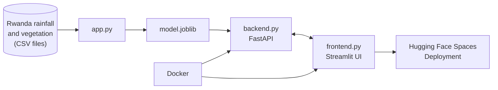

# 🌿 Rainfall Vegetation Predictor

### End-to-end vegetation forecasting - from Rwanda district rainfall to a containerized inference API

[Overview](#-overview) · [How It Works](#-how-it-works) · [Key Features](#-key-features) · [Project Structure](#-project-structure) · [Use Cases](#-industry-use-cases)

---

## 📖 Overview

In rainfall-dependent agricultural regions, understanding how precipitation translates into vegetation health is critical for crop planning, drought response, and resource allocation. Rwanda's 30 districts each exhibit distinct seasonal patterns, yet the relationship between rainfall and the **Normalized Difference Vegetation Index (NDVI)** is nonlinear, delayed, and varies district by district - making it unsuitable for simple rule-based approaches.

This project delivers a **complete end-to-end inference system** trained on 15 years of monthly Rwanda satellite and rainfall data (2000–2014). It goes from raw multi-district time-series data through statistical preprocessing, optimal-delay analysis, polynomial and ensemble **model selection**, and a production-grade **REST API** and **Streamlit UI** - all packaged for **Docker containerization** and deployed on **Hugging Face**.

---

## 🧠 How It Works

### System Architecture

| Layer | Implementation |
|---|---|
| **Training & EDA** | `app.py` - data loading, column formatting, time-series visualization, Pearson correlation, optimal-delay search, moving-average window tuning, polynomial regression, 5-fold cross-validation, and `model.joblib` export |
| **Inference artifact** | `model.joblib` - per-district fitted models, monthly rainfall climatology, training data, CV metrics, and scaler parameters |
| **Inference pipeline** | `backend.py` - FastAPI service: district lookup, monthly SMA computation, model dispatch, and vegetation-index response |
| **Interactive UI** | `frontend.py` - Streamlit app: district + month selector, rainfall scenario slider, metric cards, Altair chart with historical data and trend line |
| **Packaging & Deployment** | Single `python:3.15-slim` Docker image; Compose-orchestrated with health checks; containerized and live on **Hugging Face Spaces** |

### Step-by-Step Methodology

**1. Data Loading & Time-Series Preprocessing**

- Loads `Rainfall.csv` and `Vegetation.csv`, each with 30 district rows and 180 monthly columns (2000–2014).
- Reformats raw column headers (`Jan-00` → `JAN_2000`) for consistent datetime parsing.
- Drops the first four vegetation columns (Jan–Apr 2000), which contain no satellite readings - using `dropna(axis=1, how='all')` for a re-run-safe operation rather than a brittle positional drop.
- Aligns both datasets to a common 176-month window (May 2000 - Dec 2014) before any correlation or modelling step.

**2. Exploratory Data Analysis**

- Plots per-district time-series grids (30 subplots, 5 columns) for both rainfall and NDVI.
- Computes monthly descriptive statistics (mean, median, min, max) aggregated across all districts and years, revealing Rwanda's bimodal rainfall calendar.
- Fits an **Exponential Spatial Decay** function to Pearson inter-district correlations:

$$
\rho(d) = C_0 \, e^{-a d}
$$

  Best-fit parameters: **C₀ = 0.78, a ≈ 0** - confirming high spatial coherence across Rwanda's compact geography.

**3. Optimal Rainfall Delay (k)**

- For each integer delay **k ∈ {0 … 12}**, computes the cross-district mean Pearson correlation between rainfall lagged by k months and contemporaneous NDVI.
- Selects **k = 1 month** as the lag that maximises average correlation - vegetation greening peaks approximately one month after peak rainfall.

**4. Optimal Moving-Average Window (n)**

- For each window **n ∈ {1 … 12}**, computes a **Simple Moving Average (SMA)** of rainfall and correlates it with the aligned NDVI series.
- Selects **n = 3 months** - a 3-month SMA balances noise reduction with temporal responsiveness, outperforming both single-month values and longer windows.

**5. Feature Engineering & Model Comparison**

Three predictors are evaluated across three polynomial degrees:

| Feature | Description |
|---|---|
| Raw Rainfall | Monthly millimetres, no transformation |
| Delayed Rainfall | Rainfall shifted by k = 1 month |
| **SMA Rainfall** | 3-month rolling mean - **best predictor** |

In-sample R² and RMSE are compared across Linear, Quadratic, and Cubic fits for all three features and confirmed with 5-fold **cross-validation**.

**6. Cross-Validation & Model Selection**

A 5-fold `KFold` cross-validation (shuffled, `random_state=42`) is run across four features and three polynomial orders. Five model architectures are benchmarked on the best feature (SMA Rainfall):

| Model | CV R² | CV RMSE |
|---|---|---|
| Linear | 0.510 | 8.30 |
| **Quadratic** | **0.539** | **8.07** |
| Cubic | 0.539 | 8.09 |
| Random Forest | 0.345 | 9.67 |
| SVR | 0.487 | 8.60 |

**Quadratic polynomial regression on 3-month SMA rainfall** is selected - highest cross-validated R² at the lowest RMSE without overfitting, and interpretable coefficients unlike ensemble methods.

**7. Model Artifact Export (`model.joblib`)**

A per-district model is fitted on all training data and bundled into one self-contained artifact:

- `models` - 30 fitted scikit-learn pipelines (one per district)
- `district_cv` - per-district CV R² and RMSE
- `training_data` - historical SMA and NDVI points for chart rendering
- `monthly_rainfall_mean / std` - 2000–2014 climatology per district × calendar month
- `recent_rainfall` - last 3 months of observed data, used as default inference inputs
- `model_comparison` - full benchmark table
- `sklearn_version` - for **reproducibility** across environments

---

## ⚡ Key Features

| | Feature | Detail |
|---|---|---|
| 📐 | **Optimal-lag & window search** | Data-driven selection of the 1-month rainfall delay and 3-month SMA window that maximise Pearson correlation with NDVI across all 30 districts |
| 🧠 | **Per-district polynomial models** | A separate quadratic pipeline per district captures local rainfall–vegetation dynamics that a single pooled model would average away |
| 🔌 | **Production REST API** | `GET /info`, `GET /districts/{district}`, `POST /predict`, `GET /predict_month` - Pydantic-validated, with range-checking and out-of-distribution warnings |
| 🖥️ | **Interactive Streamlit UI** | Alphabetically sorted district + month selectors with "Select" placeholders, rainfall scenario slider (Much Drier → Much Wetter), metric cards, and an Altair chart shown on demand |
| 🐳 | **One-image Docker deployment** | Same `python:3.15-slim` image runs both services; Compose wires them with a health check and service-name networking |
| 🤗 | **Hugging Face deployment** | Deployed as a containerized Space on **Hugging Face**, providing public availability and cloud-hosted inference API endpoints |

---

## 📁 Project Structure

| File | Role |
|---|---|
| `app.py` | 🔬 Training workflow written as `# %%` cells: EDA, Pearson correlation, lag and window optimisation, polynomial regression, 5-fold cross-validation, model comparison, and `model.joblib` export |
| `backend.py` | 🧩 **FastAPI** inference service - district lookup, SMA computation, model dispatch, climatology-based monthly predictions, and an out-of-range warning flag |
| `frontend.py` | 🖥️ **Streamlit** UI - district and month dropdowns, rainfall scenario slider, two metric cards with error bounds, and an Altair 3-layer chart (scatter · trend line · prediction marker) |
| `model.joblib` | 🤖 Serialized inference bundle: 30 district pipelines, CV metrics, monthly climatology, training points, and benchmark table |
| `Rainfall.csv` | 📊 Monthly rainfall (mm) for 30 Rwanda districts, 2000–2014 |
| `Vegetation.csv` | 🌿 Monthly NDVI readings for 30 Rwanda districts, 2000–2014 |
| `Dockerfile` | 🐳 `python:3.15-slim` image used for backend/frontend services and **Hugging Face Spaces** container runtime |
| `docker-compose.yml` | 🧱 Runs backend on `:8000` and frontend on `:8501`; frontend waits on the backend's `/` health check |
| `.dockerignore` | 🧹 Keeps training scripts and raw CSVs out of the production image |
| `requirements.txt` | 📦 Pinned dependency versions for deterministic builds |

---

## 💡 Industry Use Cases

| Domain | How this system helps |
|---|---|
| 🌾 **Agricultural planning** | Extension officers can query any of Rwanda's 30 districts and calendar months to anticipate vegetation stress before it becomes visible in the field, supporting timely irrigation or input decisions |
| 🚨 **Drought early warning** | The rainfall scenario slider lets analysts model a 20-40% rainfall deficit and see the predicted NDVI drop before the dry season arrives, giving humanitarian planners a quantified lead time |
| 📡 **Remote-sensing analytics platforms** | The `/predict_month` REST endpoint can be called in a data pipeline that ingests satellite precipitation products (CHIRPS, GPM), replacing the climatology average with a real-time observed value |
| 🔁 **Template for other NDVI regions** | The pipeline - SMA **feature engineering** → per-site polynomial regression → per-site CV → REST API → Streamlit UI - transfers directly to any country with district-level NDVI and rainfall time series |

---

## 📜 License & Acknowledgements

Released under the [MIT License](LICENSE).

**Data:** Rwanda district-level rainfall and NDVI data from satellite remote-sensing archives (2000–2014).

Built with [scikit-learn](https://scikit-learn.org), [SciPy](https://scipy.org), [FastAPI](https://fastapi.tiangolo.com), [Streamlit](https://streamlit.io), [Altair](https://altair-viz.github.io), [Docker](https://www.docker.com), and deployed on [Hugging Face](https://huggingface.co).
