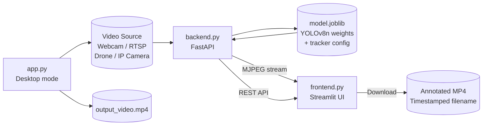

<div align="center">

# 🛰️ Disaster Response Drone

### Real-time aerial survivor detection - from raw video feed to a deployable operator console


[Overview](#-overview) · [How It Works](#-how-it-works) · [Key Features](#-key-features) · [Project Structure](#-project-structure) · [Use Cases](#-use-cases)

</div>

---

## 📖 Overview

In disaster scenarios - earthquakes, floods, collapsed buildings - first responders have minutes to locate survivors across terrain that is too dangerous or too large to cover on foot. Aerial drones can sweep wide areas quickly, but a human operator watching a live feed cannot track every person reliably, loses count when the same survivor reappears, and has no durable record of what was seen.

**Disaster Response Drone** turns a standard drone video feed into an intelligent, real-time operator console. It runs a **YOLOv8n** object detector with **ByteTrack** persistent tracking on a live video stream - from a webcam, an RTSP drone feed, or any IP camera URL - and maintains a **unique survivor count** that is robust to re-entries and momentary disappearances. Every identified survivor gets a persistent track ID, so the same person is never double-counted. The session is recorded, re-encoded to a browser-playable MP4, and offered for download the moment the operator stops the feed.

The system is split into a **FastAPI inference backend** and a **Streamlit operator dashboard**, decoupled so the AI model runs at full speed regardless of UI rendering. A standalone `app.py` script provides a lightweight desktop mode - no server required - for single-operator field use.

---

## 🧠 How It Works

### System Architecture



| Layer | Implementation |
|---|---|
| **Standalone script** | `app.py` - single-file desktop mode: captures webcam, runs YOLOv8n tracking at `conf=0.5`, draws bounding boxes, displays live count, writes `output_video.mp4`, exits on `e` or window close |
| **Model artifact** | `model.joblib` - self-contained bundle: YOLOv8n weights bytes, ByteTrack config, detection thresholds, and image size, loaded once at backend startup |
| **Inference backend** | `backend.py` - FastAPI service: two-thread architecture (video reader + AI detector), session management, MJPEG stream, MP4 recording, and re-encoding |
| **Operator console** | `frontend.py` - Streamlit dashboard: single-page operator interface with live video, real-time telemetry cards, and post-session review |

---

### Step 1 · Model Bundle: `model.joblib`

At first startup, `backend.py` calls `build_model()`, which downloads `yolov8n.pt` and serializes the following into `model.joblib` via `joblib.dump(..., compress=3)`:

| Key | Value | Purpose |
|---|---|---|
| `weights_bytes` | Raw `.pt` file bytes | Self-contained - no separate weight file needed at serving time |
| `target_classes` | `[0]` | Person class only (COCO index 0) |
| `conf` | `0.35` | Detection confidence threshold |
| `iou` | `0.5` | NMS IoU threshold |
| `imgsz` | `640` (CPU: auto-lowered to `480`) | Inference image size |
| `tracker` | `bytetrack.yaml` | ByteTrack persistent multi-object tracker |
| `min_track_frames` | `3` | Frames a track ID must be seen before being counted as a confirmed survivor |

On subsequent starts, `model.joblib` is loaded directly - no rebuild. The weights are written to a temp file and loaded into a warm YOLO model with **three dummy-frame warm-up passes** so the first real frame is detected without delay.

---

### Step 2 · Two-Thread Inference Pipeline

The core design separates **video throughput** from **AI speed**, so the live feed never lags regardless of CPU inference time.

```
_read_loop (Thread 1)          _detect_loop (Thread 2)
─────────────────────          ───────────────────────
cap.read() → raw frame    →→→  model.track(latest raw frame)
_draw(last known boxes)        update self.boxes, self.confirmed
write annotated frame to MP4   update self.in_view, self.det_fps
encode JPEG → self.latest
```

- **Thread 1** (`_read_loop`) reads frames from the camera at native speed, draws the most recently known bounding boxes on each frame, records to a raw MP4, and publishes the JPEG to the MJPEG stream. It sets `cap.set(CAP_PROP_BUFFERSIZE, 1)` to always use the newest available frame and never queue stale ones.
- **Thread 2** (`_detect_loop`) picks up the newest raw frame whenever it changes, runs `model.track()` with ByteTrack persistence, and updates the shared box list and confirmed-survivor set. If no GPU is available, `imgsz` is automatically capped at 480 to reduce CPU inference time.

**Survivor counting:** a track ID is added to `confirmed` only after it appears in `min_track_frames` (3) consecutive detections, filtering one-frame ghost detections. The confirmed set is a Python `set`, so the same person re-entering the frame never increments the count.

---

### Step 3 · Recording & Re-encoding

When the operator presses **Stop Capturing**:

1. Both threads are joined with a 15-second timeout.
2. `_finalize()` measures the real elapsed frame rate from `t_first`/`t_last` timestamps.
3. `ffmpeg` (via `imageio-ffmpeg`) re-encodes the raw MP4 to H.264 (`libx264`, `yuv420p`, `+faststart`) at the corrected frame rate, so the file plays correctly in any browser.
4. The raw file is deleted; only the final MP4 is kept in the OS temp directory and served for download.
5. After the Streamlit client fetches the video, the server copy is deleted automatically - no output folder is left in the project directory.

---

### Step 4 · REST API Endpoints (`backend.py`)

| Method | Endpoint | Description |
|---|---|---|
| `GET` | `/health` | Model status, device (CPU/CUDA), uptime, active session ID |
| `POST` | `/session/start` | Start a new session; body: `{"source": "0"}` or a stream URL |
| `GET` | `/session/status` | Live telemetry: in-view count, unique survivors, FPS, elapsed time |
| `GET` | `/session/stream` | MJPEG multipart stream of annotated frames |
| `POST` | `/session/stop` | Stop recording, finalize MP4; returns session summary |
| `GET` | `/session/{sid}/download` | Serve the finalized MP4 for download |
| `DELETE` | `/session/{sid}` | Discard the MP4 and clear the session |

---

### Step 5 · Operator Dashboard (`frontend.py`)

The Streamlit UI has three states that transition based on operator actions:

```
flowchart LR
    IDLE(["IDLE"]) -->|"Begin Capturing"| LIVE(["LIVE"])
    LIVE -->|"Stop Capturing"| REVIEW(["REVIEW"])
    REVIEW -->|"Capture Again / Discard"| IDLE
```

| State | What the operator sees |
|---|---|
| **Idle** | System-ready badge, video source selector (webcam port or stream URL), **Begin Capturing** button |
| **Live** | Full-width annotated video stream, four live telemetry cards (Total Survivors · In View · Video FPS · Elapsed), AI detection speed caption, **Stop Capturing** button |
| **Review** | Session summary cards, inline video player, **Discard** (red) · **Download MP4** (blue) · **Capture Again** (green) buttons; filename is `Survivor_Detection_YYYY-MM-DD_HH-MM.mp4` |

The telemetry panel refreshes every second via `@st.fragment(run_every=1)` without re-rendering the video frame, keeping the UI responsive. If the browser is refreshed mid-session, the UI re-attaches to the running session automatically.

---

## ⚡ Key Features

| | Feature | Detail |
|---|---|---|
| 🎯 | **Unique survivor counting** | ByteTrack persistent IDs + 3-frame confirmation gate eliminate double-counting and ghost detections |
| ⚡ | **Lag-free live feed** | Video reader and AI detector run on separate threads; camera buffer pinned to 1 frame so the display never shows stale video |
| 🔌 | **Any video source** | Webcam index (0, 1, 2…), RTSP drone stream, HTTP/MJPEG IP camera, or any OpenCV-compatible URL |
| 📦 | **Self-contained artifact** | `model.joblib` bundles YOLOv8n weights + all inference config in one file; backend serves without loose `.pt` files |
| 🎬 | **Corrected MP4 export** | Real FPS measured from frame timestamps; `ffmpeg` re-encodes to browser-playable H.264 with correct playback speed |
| 🗂️ | **Zero project clutter** | Recordings live in the OS temp directory and are deleted server-side after download; no `outputs/` folder in the project |
| 🔁 | **Session resume** | Refreshing the browser mid-session re-attaches to the live feed without data loss |
| 🩺 | **Health monitoring** | `GET /health` reports model load status, compute device, uptime, and active session for operator awareness |
| 🖥️ | **Desktop mode** | `app.py` runs standalone with `cv2.imshow`, no server needed; saves `output_video.mp4` locally |
| ♻️ | **Reproducibility** | All dependencies pinned in `requirements.txt`; `model.joblib` rebuilt deterministically if missing |

---

## 📁 Project Structure

```text
Disaster Response Drone/
├── app.py               # Standalone desktop script: webcam → detection → output_video.mp4
├── backend.py           # FastAPI inference service: session management, MJPEG stream, REST API
├── frontend.py          # Streamlit operator dashboard: idle → live → review flow
├── model.joblib         # Serialized bundle: YOLOv8n weights, ByteTrack config, thresholds
├── yolov8n.pt           # YOLOv8 nano weights (COCO, downloaded by ultralytics on first run)
└── requirements.txt     # Pinned Python dependencies for reproducible setup
```

| File | Role |
|---|---|
| `app.py` | Lightweight field script - loads `yolov8n.pt`, opens the webcam, runs `model.track()` at `conf=0.5`, draws `Survivor (XX%)` boxes, overlays a live-count HUD, and writes every annotated frame to `output_video.mp4`. Exits cleanly on `e` keypress or window close, then prints total unique survivors. |
| `backend.py` | FastAPI service - loads `model.joblib` at startup, runs three warm-up passes on a dummy frame, then manages one `Session` at a time. Each session spawns two threads: a video reader at camera speed and an AI detector that always processes the newest frame. Provides MJPEG streaming, session telemetry, and MP4 finalization via `ffmpeg`. |
| `frontend.py` | Streamlit dashboard - single-page operator console with a dark drone-ops theme (Rajdhani/Inter fonts, card-based telemetry, pulsing LIVE badge). Talks to `backend.py` only via HTTP; no model imports. Downloads the annotated MP4 into browser memory and offers it for save or discard. |
| `model.joblib` | `joblib`- compressed bundle containing YOLOv8n weight bytes, detection config (`conf=0.35`, `iou=0.5`, `imgsz=640`), ByteTrack tracker reference, `min_track_frames=3`, and bundle metadata. Rebuilt automatically on first run if absent. |
| `yolov8n.pt` | YOLOv8 nano COCO weights - 6.2 MB, downloaded by `ultralytics` on demand. Can be replaced with domain-specific weights (VisDrone, SAR, thermal) by setting the `WEIGHTS` environment variable before starting the backend. |
| `requirements.txt` | Twelve pinned packages (`numpy==2.5.4`, `ultralytics==8.4.211`, `torch==2.15.0`, `fastapi==0.162.5`, `streamlit==1.67.0`, etc.) for a fully deterministic build. |

---

## 💡 Use Cases

| Domain | How This System Helps |
|---|---|
| 🌪️ **Natural disaster response** | Drone operators sweep earthquake or flood zones and get a live unique-survivor count without manually tallying a chaotic video feed |
| 🔥 **Wildfire & evacuation support** | Identify people in areas cut off by fire lines; the timestamped MP4 gives incident commanders a durable record of who was spotted and when |
| 🏔️ **Search and rescue (SAR)** | Swap in thermal or VisDrone-trained weights and connect to any RTSP stream from a SAR drone; the system works with any OpenCV-compatible source |
| 🏗️ **Construction site safety** | Monitor restricted zones in real time; the unique-ID tracker counts how many individuals are present without counting re-entries |
| 🎓 **Computer vision research** | The two-thread reader/detector architecture and `model.joblib` bundling pattern are reusable templates for any real-time detection system where inference speed is slower than camera frame rate |
| 🔁 **Custom model rollout** | Replace `model.joblib` by setting `WEIGHTS` and restarting - `backend.py` and `frontend.py` require no code changes |

### Natural Next Steps

- **Domain-specific weights:** fine-tune on VisDrone, HERIDAL, or a thermal-imagery SAR dataset to improve detection at altitude and in low-light conditions.
- **Multi-drone sessions:** extend the session model to handle simultaneous feeds from multiple drones, with a merged unique-ID count across all streams.
- **GPS coordinate overlay:** fuse drone telemetry with detection bounding boxes to log survivor GPS coordinates alongside the video for handoff to ground teams.
- **Automated alert:** add a webhook or SMS trigger when the unique survivor count crosses a threshold, so the operator does not need to watch the screen continuously.
- **Cloud deployment:** run `backend.py` on a GPU-equipped cloud VM, set `PUBLIC_API_URL` to the server's public IP, and open the Streamlit UI from any device in the field.

---

## 📄 License & Acknowledgements

Released under the **MIT License** (add a `LICENSE` file and update the author name and year).

**Model:** [YOLOv8n](https://github.com/ultralytics/ultralytics) — Ultralytics, trained on [COCO](https://cocodataset.org/).
**Tracker:** ByteTrack, integrated via `ultralytics` and `lapx==0.13.1`.

Built with [Ultralytics YOLOv8](https://github.com/ultralytics/ultralytics) · [FastAPI](https://fastapi.tiangolo.com) · [Streamlit](https://streamlit.io) · [OpenCV](https://opencv.org) · [PyTorch](https://pytorch.org) · [imageio-ffmpeg](https://github.com/imageio/imageio-ffmpeg)
